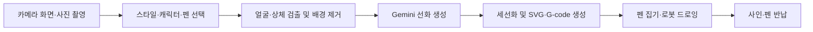

# Drawing Robot

## 1. 드로잉 로봇 소개

사용자의 사진을 AI 선화로 변환하고, 두산 A0509 로봇이 실제 종이에 그려 주는 드로잉 로봇 서비스입니다. ZED 2i로 촬영한 사진에 원하는 스타일이나 캐릭터를 적용하고, 생성된 이미지에서 펜의 이동 경로를 만들어 드로잉과 사인까지 수행합니다.

### 주요 기능

- PyQt6 키오스크 UI를 통한 카메라 확인, 사진 촬영, 스타일·캐릭터·펜 선택
- MediaPipe를 이용한 얼굴·상체 영역 검출과 배경 제거
- Gemini API를 이용한 초상화 선화 및 캐릭터 합성 이미지 생성
- 이미지 세선화, SVG·G-code 경로 생성
- 펜 집기 → 그림 그리기 → 사인 → 펜 반납 자동 수행
- 촬영 원본, 중간 이미지, 최종 이미지·경로의 세션별 저장

### 사용 장비 및 소프트웨어

| 구분 | 구성 |
|---|---|
| 로봇 | Doosan Robotics A0509 |
| 카메라 | Stereolabs ZED 2i |
| 작업 도구 | 그리퍼, 펜 거치대, 볼펜·네임펜·마카, 종이 고정 작업대 |
| 운영체제 | Ubuntu 22.04 LTS |
| 로봇 미들웨어 | ROS 2 Humble, 두산 ROS 2 드라이버 |
| Python | 시스템 Python 3.10 기반 venv |
| UI | PyQt6, `user_gui_kiosk_ver2.py` |
| 이미지 처리 | OpenCV, MediaPipe, rembg, ONNX Runtime |
| 생성 AI | Gemini API (`google-genai`) |

기존 환경에서 Ubuntu 22.04.5, Python 3.10.12, ROS 2 Humble로 UI import와 카메라·UI 표시를 확인했습니다. 새 PC에서의 전체 설치와 실제 드로잉은 장비 설정을 포함해 별도로 검증해야 합니다.

> **실제 동작 전 확인:** 현재 UI는 이미지 생성이 완료되면 로봇 실행 프로그램을 자동으로 시작합니다. UI 화면만 점검할 때는 생성 시작 버튼을 누르지 마세요. 로봇 좌표·TCP·펜 거치대·그리퍼 설정은 기존 설치 장소 기준이므로 새 장비에 그대로 적용하면 안 됩니다.

## 2. 드로잉 로봇 동작 과정



### 2.1 사진 촬영과 옵션 선택

`user_gui_kiosk_ver2.py`에서 카메라 영상을 확인하고 사진을 촬영합니다. 초상화 스타일 또는 캐릭터 합성 모드와 사용할 펜을 선택합니다.

**시작 화면 이미지 위치:** `docs/images/01_start_screen.png`

<!-- 시작 화면을 준비한 뒤 아래 주석을 해제하세요.

-->

**촬영 원본 이미지 위치:** `docs/images/02_original_photo.png`

<!--

-->

### 2.2 이미지 변환

`modules/sketch_processor.py`가 얼굴 검출을 먼저 시도하고, 실패하면 사람·상체 영역을 검출합니다. `modules/image_processor.py`에서 배경 제거와 영상 보정을 수행하고, `modules/gemini_sketch.py`가 Gemini에 이미지와 프롬프트를 보내 선화를 생성합니다. 캐릭터 모드에서는 선택한 캐릭터 이미지도 함께 전달합니다.

현재 코드의 모델 ID는 `gemini-3.1-flash-image-preview`입니다. 해당 모델에 접근할 수 있는 API 키와 인터넷 연결이 필요하며, API 사용에는 계정 정책에 따른 비용이 발생할 수 있습니다. 촬영 이미지는 이 단계에서 외부 API로 전송됩니다.

**변환 이미지 위치:** `docs/images/03_generated_sketch.png`

<!--

-->

### 2.3 드로잉 경로 생성

`modules/thinning_converter.py`가 선화에 이진화·세선화를 적용하고 SVG와 G-code(`.nc`)를 생성합니다. 경로는 비율을 유지하며 설정된 100 × 100 mm 영역에 맞춰집니다. 실제 접촉 높이와 설치 위치는 로봇 코드의 TCP·좌표·Z 보정 설정에 영향을 받습니다.

결과는 다음 위치에 저장됩니다.

```text
data/<YYYYMMDD_HHMMSS>_session/
└── 1_gui_capture/
    ├── raw/             # original.jpg
    ├── intermediate/    # 보정 이미지·생성 선화
    └── processed/       # photo_gemini.nc, photo_gemini.svg
```

### 2.4 로봇 드로잉

이미지 처리 완료 후 UI가 `modules/fianl_drawing_robot.py`를 subprocess로 실행합니다. 파일명의 `fianl`은 현재 코드에 사용된 이름입니다.

로봇 프로그램은 G-code를 로봇 동작 코드로 변환하고, ROS 2의 두산 서비스 API를 통해 펜 집기, 드로잉, 사인, 펜 반납을 수행합니다. UI와 subprocess는 `sys.executable`을 통해 같은 Python 환경을 사용합니다.

**실제 로봇 드로잉 결과 위치:** `docs/images/04_robot_drawing.png`

<!--

-->

위 네 이미지는 저장소 소개용입니다. 실행용 캐릭터·미리보기 폴더와는 별도입니다. README를 저장소 루트에 배치했을 때의 상대 경로를 사용했습니다.

## 3. 서비스 구축 및 실행 방법

아래 명령은 Ubuntu 22.04, ROS 2 Humble, Bash, 사용자 홈 `/home/ubuntu`를 기준으로 합니다. 사용자 이름이 다르면 `/home/ubuntu` 경로를 해당 홈 경로로 바꾸세요. 이미 설치한 드라이버·패키지는 상태를 확인한 후 재사용합니다.

이 저장소는 다음 형태로 배치한다고 가정합니다.

```text
Drawing_Robot/
├── README.md
├── user_gui_kiosk_ver2.py
├── requirements.txt
├── config/
└── modules/
```

기존 `drawing_robot/` 폴더 안의 파일과 하위 폴더를 저장소 루트에 업로드합니다. clone 후 `Drawing_Robot/drawing_robot/`처럼 이중 폴더로 배치하지 않습니다.

`drawing_robot`은 기존 Python 프로그램으로 실행합니다. 새 ROS 2 패키지를 만들거나 카메라 토픽 구독 방식으로 변경하지 않습니다.

### 3.1 운영체제·ROS·Python 확인

**실행 위치: 아무 디렉터리**

```bash
cat /etc/os-release
/usr/bin/python3 --version
ls /opt/ros
```

기준 결과는 Ubuntu 22.04, Python 3.10.x, `humble`입니다. 다른 배포판·Python 조합에 이 설치 절차를 그대로 적용하지 마세요.

ROS 2가 없는 PC는 [ROS 2 Humble 공식 Ubuntu 설치 안내](https://docs.ros.org/en/humble/Installation/Ubuntu-Install-Debs.html)에 따라 apt 저장소 설정 및 `ros-humble-desktop` 설치를 먼저 완료합니다. 이미 Humble이 동작하는 PC에서는 재설치하지 않습니다.

**실행 위치: 아무 디렉터리 — 기본 개발 도구 설치**

```bash
sudo apt update
sudo apt install git build-essential cmake \
    python3-venv python3-pip python3-rosdep \
    python3-colcon-common-extensions python3-opencv v4l-utils

source /opt/ros/humble/setup.bash
```

정상 결과: 설치 성공, `source` 오류 없음. 시스템 Python·pip·CUDA 전체를 업그레이드할 필요는 없습니다.

### 3.2 워크스페이스 생성 및 드라이버 clone

**실행 위치: 아무 디렉터리 → `/home/ubuntu/robot_ws/src`**

```bash
mkdir -p /home/ubuntu/robot_ws/src
cd /home/ubuntu/robot_ws/src

git clone --branch humble https://github.com/DoosanRobotics/doosan-robot2.git
git clone https://github.com/stereolabs/zed-ros2-wrapper.git
```

정상 결과: `src/doosan-robot2`, `src/zed-ros2-wrapper` 생성. 기존 폴더가 있으면 clone 명령을 생략하고 기존 설치 버전을 유지합니다.

두산 드라이버는 [공식 Humble 브랜치 안내](https://github.com/DoosanRobotics/doosan-robot2/tree/humble)를 참고합니다. 컨트롤러 DRCF 2.x/3.x와 드라이버 빌드 옵션의 대응을 확인해야 합니다. 이 문서는 실제 장비 실행을 다루므로 가상 로봇용 Docker·에뮬레이터 설치는 필수가 아닙니다.

### 3.3 ZED SDK 및 ZED 드라이버 준비

ZED ROS wrapper를 빌드하려면 NVIDIA 드라이버, 호환 CUDA, ZED SDK가 먼저 준비되어 있어야 합니다. [ZED SDK 다운로드](https://www.stereolabs.com/developers/release/)에서 Ubuntu 22.04와 설치된 CUDA에 맞는 설치 파일을 선택합니다. 정상 동작 중인 NVIDIA·CUDA 환경은 유지합니다.

**실행 위치: 아무 디렉터리 — 기존 GPU 환경 확인**

```bash
nvidia-smi
```

정상 결과: GPU와 드라이버 정보 표시. 실패하면 ZED SDK 설치 전에 NVIDIA 환경부터 확인합니다.

**실행 위치: 다운로드한 SDK 설치 파일이 있는 디렉터리**

```bash
cd /home/ubuntu/Downloads
read -r -p "다운로드한 ZED SDK .run 파일명: " ZED_INSTALLER
chmod +x "$ZED_INSTALLER"
./"$ZED_INSTALLER"
```

파일명은 실제 다운로드한 이름을 입력합니다. 설치 프로그램 안내에 따라 진행하고, SDK와 wrapper가 요구하는 버전을 맞춥니다. 구버전 SDK를 유지할 때는 [ZED wrapper 릴리스](https://github.com/stereolabs/zed-ros2-wrapper/releases)에서 대응 버전을 선택합니다. SDK 설치 후 ZED Explorer로 장치 인식과 영상을 확인한 다음 Explorer를 종료합니다.

> 현재 ver2 UI는 ZED ROS 토픽이나 깊이 영상을 사용하지 않고 `cv2.VideoCapture(0)`으로 카메라를 직접 엽니다. ZED SDK·ROS wrapper는 장비 점검 및 ROS 연동 환경용이며, UI만 사용할 때 wrapper 노드를 실행할 필요는 없습니다. Python ZED API(`pyzed`)도 현재 UI의 필수 실행 경로가 아닙니다.

### 3.4 드라이버 의존성 설치 및 빌드

**실행 위치: 아무 디렉터리 — rosdep 최초 초기화**

```bash
if [ ! -f /etc/ros/rosdep/sources.list.d/20-default.list ]; then
    sudo rosdep init
fi
rosdep update
```

**실행 위치: `/home/ubuntu/robot_ws` — venv가 활성화되지 않은 새 터미널**

```bash
source /opt/ros/humble/setup.bash
cd /home/ubuntu/robot_ws

rosdep install --from-paths src/doosan-robot2 src/zed-ros2-wrapper \
    --ignore-src --rosdistro humble -r -y

colcon build --symlink-install --packages-skip zed_debug \
    --cmake-args -DCMAKE_BUILD_TYPE=Release

source /home/ubuntu/robot_ws/install/setup.bash
ros2 pkg prefix dsr_bringup2
ros2 pkg prefix zed_wrapper
```

정상 결과: 빌드 실패 패키지 없음, 두 명령 모두 workspace의 `install/` 아래 경로 표시. `rosdep`에서 해결하지 못한 의존성이 있으면 먼저 해결한 뒤 빌드합니다.

DRCF 3.x 컨트롤러라면 위 기본 빌드 대신 두산 공식 안내에 따라 `--cmake-args -DCMAKE_BUILD_TYPE=Release -DDRCF_VER=3`를 사용합니다. 컨트롤러 버전을 추측해서 옵션을 선택하지 마세요.

### 3.5 서비스 저장소 clone

**실행 위치: `/home/ubuntu/robot_ws/src`**

```bash
cd /home/ubuntu/robot_ws/src
git clone https://github.com/juhh0/Drawing_Robot.git
cd /home/ubuntu/robot_ws/src/Drawing_Robot
test -f user_gui_kiosk_ver2.py && echo "UI 파일 확인 완료"
```

정상 결과: `UI 파일 확인 완료`. 이 문서에서 이후 사용하는 **프로젝트 루트**는 `/home/ubuntu/robot_ws/src/Drawing_Robot`입니다. 이전 설치의 `src/drawing_robot` 경로와 혼동하지 마세요.

### 3.6 가상환경 준비

**실행 위치: 아무 디렉터리 — 기존 venv 확인**

```bash
if [ -f /home/ubuntu/venvs/drawing_robot/pyvenv.cfg ]; then
    cat /home/ubuntu/venvs/drawing_robot/pyvenv.cfg
    /home/ubuntu/venvs/drawing_robot/bin/python --version
else
    echo "drawing_robot venv 없음"
fi
```

기존 venv는 Python 3.10과 `include-system-site-packages = true`인지 확인합니다. 적합하면 재사용하고, 아래 생성 명령을 생략합니다. 호환되지 않는 기존 venv는 덮어쓰지 말고 별도 경로에 보존한 후 준비합니다.

**실행 위치: 아무 디렉터리 — venv가 없을 때만 생성**

```bash
/usr/bin/python3 -m venv --system-site-packages /home/ubuntu/venvs/drawing_robot
```

**실행 위치: 아무 디렉터리 → 프로젝트 루트 — 환경 활성화**

```bash
source /opt/ros/humble/setup.bash
source /home/ubuntu/robot_ws/install/setup.bash
source /home/ubuntu/venvs/drawing_robot/bin/activate
cd /home/ubuntu/robot_ws/src/Drawing_Robot

python --version
python -m pip --version
python -c 'import sys; print(sys.executable)'
```

정상 결과: Python 3.10.x, Python·pip 경로가 venv 내부. `--system-site-packages`는 기존 시스템 패키지를 활용하기 위한 설정이며, ROS overlay를 `source`하는 과정도 필요합니다. 관련 동작은 [Python venv 문서](https://docs.python.org/3.10/library/venv.html)를 참고하세요.

### 3.7 Python 의존성 확인 및 설치

| 구분 | 패키지 |
|---|---|
| pip 또는 기존 시스템 패키지 | NumPy, OpenCV contrib 기능, Pillow, svgwrite, SciPy, MediaPipe, rembg, torch, torchvision, google-genai, python-dotenv |
| requirements.txt에서 빠진 항목 | PyQt6, CPU용 onnxruntime |
| ROS·두산 드라이버 제공 | rclpy, dsr_msgs2, DR_init, DSR_ROBOT2 |
| 현재 ver2에서 선택 항목 | pyzed, onnxruntime-gpu, 로컬 Anime 가중치 |

`torch`와 `torchvision`은 Gemini 처리 자체에는 사용되지 않지만 `modules/__init__.py`의 간접 import 때문에 현재 코드 구조에서 필요합니다. `DR_init`, `DSR_ROBOT2`, `rclpy`는 pip로 설치하지 않습니다.

먼저 아래 3.9의 import 검사를 시도합니다. 기존 환경이 모두 통과하면 재설치할 필요가 없습니다. 새 PC에서 누락된 패키지는 다음 명령으로 설치합니다.

**실행 위치: 프로젝트 루트, venv 활성화 상태 — 누락 항목만 설치**

```bash
python -m pip install \
    "numpy==1.26.4" "PyQt6==6.4.2" \
    "onnxruntime==1.23.2" "rembg==2.0.69" \
    "mediapipe==0.10.35" "scipy==1.15.3" \
    Pillow svgwrite "google-genai==2.5.0" "python-dotenv==1.2.2"
```

위 주요 버전은 기존 환경에서 import를 확인한 조합입니다. 신규 PC 전체 설치를 자동 보장하는 고정 lock 파일은 아닙니다. Python 3.10을 지원하는 rembg 2.0.69를 사용하며, 무조건 최신 버전으로 올리지 않습니다. [rembg 2.0.69 Python 지원 조건](https://pypi.org/project/rembg/2.0.69/)

torch·torchvision이 없으면 CPU용 쌍을 함께 설치합니다. 기존 GPU 버전이 정상 동작하면 유지합니다.

```bash
# 실행 위치: 프로젝트 루트, venv 활성화 상태
python -m pip install torch torchvision --index-url https://download.pytorch.org/whl/cpu
```

OpenCV는 아래 검사에서 `True`이면 기존 것을 유지합니다.

```bash
python - <<'PY'
import cv2
print(cv2.__version__, cv2.__file__)
print(hasattr(getattr(cv2, "ximgproc", None), "thinning"))
PY
```

`cv2`가 없거나 세선화 기능이 없을 때만 다음을 사용합니다.

```bash
python -m pip install "opencv-contrib-python==4.11.0.86" "numpy==1.26.4"
```

OpenCV의 pip 배포판들은 모두 같은 `cv2` 이름을 사용합니다. `opencv-python`, `opencv-contrib-python`, headless 변형을 중복 설치하지 말고, 설치 전 현재 환경을 확인하세요. 시스템 OpenCV를 제거할 필요는 없습니다. [OpenCV 설치 안내](https://pypi.org/project/opencv-contrib-python/4.11.0.86/)

### 3.8 API 키 및 리소스 배치

**실행 위치: 프로젝트 루트**

```bash
mkdir -p data/characters data/preview
touch .env
chmod 600 .env
nano .env
```

편집기에서 아래 환경변수를 설정합니다. 실제 키는 Git·채팅·로그에 남기지 마세요.

```dotenv
GEMINI_API_KEY=발급받은_실제_API_키
```

`.env`는 숨김 파일입니다. Ubuntu 탐색기에서는 `Ctrl + H`로 표시합니다. 코드의 `load_dotenv()`는 이미 터미널에 설정된 동일 이름의 환경변수를 기본적으로 덮어쓰지 않습니다.

```bash
# 실행 위치: 프로젝트 루트, venv 활성화 상태
python - <<'PY'
import os
from dotenv import load_dotenv
load_dotenv(".env")
print("GEMINI_API_KEY:", "설정됨" if os.getenv("GEMINI_API_KEY", "").strip() else "미설정")
PY
```

정상 결과: `설정됨`. 키 값 자체는 출력하지 않습니다.

| 리소스 | 프로젝트 루트 기준 위치 | 준비 방법·없을 때 영향 |
|---|---|---|
| API 키 | `.env` | 직접 설정. 없으면 UI는 열리지만 Gemini 생성 불가 |
| 캐릭터 원본 | `data/characters/` | 기존 PC에서 복사 또는 직접 준비. 없으면 캐릭터 기능 제한 |
| 프리뷰 | `data/preview/` | 직접 준비. 없으면 안내 문구 표시 |
| 초상화·캐릭터 프롬프트 | `config/gemini_prompts.json`, `config/gemini_character_prompts.json` | 업로드 대상. 누락·파싱 실패 시 기본 프롬프트로 대체 |
| 얼굴·포즈 모델 | `modules/models/face_detection_short_range.tflite`, `modules/models/pose_landmarker_lite.task` | 기존 프로젝트의 실제 모델 파일 포함. 없으면 import 중 자동 다운로드를 시도하며 실패 시 UI 실행 불가 |
| 배경 제거 모델 | 기본 `~/.u2net/u2net.onnx` | Git 외부 캐시. 최초 처리 시 다운로드 또는 기존 PC에서 복사. 실패하면 배경 제거 생략 가능 |
| 사인 | `Robot_Sign.py`, `Robot_Sign.nc` | 업로드 대상. 누락 시 드로잉 후 사인 단계 실패 가능 |
| 로컬 Anime 모델 | `modules/models/anime_style/netG_A_latest.pth` | 기존 프로젝트에 포함되어 있으나 현재 ver2 Gemini 경로에서는 사용하지 않음 |
| 동작 코드 | `modules/output_linear.py`, `modules/output_linear_sign.py` | 실행 중 생성·덮어쓰기. `modules/` 쓰기 권한 필요 |

기존 프로젝트의 `.gitignore`는 `.env`와 `data/*`를 제외합니다. 폴더만 복사해 업로드해도 이 파일들이 Git에 포함된다고 가정하지 마세요. 캐릭터·프리뷰는 사용자별로 별도 배치하며, API 키는 업로드하지 않습니다. 모델을 Git LFS로 배포한다면 포인터가 아닌 실제 모델까지 다운로드해야 합니다.

#### 초상화 미리보기 파일명

현재 `config/gemini_prompts.json`의 키와 대응합니다. 아래 파일을 `data/preview/`에 넣습니다.

| 스타일 | 우선 파일명 | 대체 파일명 |
|---|---|---|
| 기본스케치 | `portrait_기본스케치.png` | `portrait_style_1.png` |
| 익살스런캐리커처 | `portrait_익살스런캐리커처.png` | `portrait_style_2.png` |
| 귀여운캐리커쳐 | `portrait_귀여운캐리커쳐.png` | `portrait_style_3.png` |
| 미니어쳐캐리커쳐 | `portrait_미니어쳐캐리커쳐.png` | `portrait_style_4.png` |

#### 캐릭터 미리보기 파일명

원본 예시: `data/characters/11-06_A_인사.png`

현재 캐릭터 동작 JSON에 대응하는 파일은 다음과 같습니다.

```text
data/preview/character_11-06_A_인사_action_1.png
data/preview/character_11-06_A_인사_action_2.png
data/preview/character_11-06_A_인사_action_3.png
data/preview/character_11-06_A_인사_action_4.png
```

순서대로 `1. 어깨 위의 파트너`, `2. 어깨 위의 파트너_B`, `3. 머리 위의 요정`, `4. 함께 손을 흔드는 모습`에 대응합니다.

일반 규칙은 `character_<캐릭터명>_action_<가공된 동작명>.png`이며, 대체 규칙은 `character_<캐릭터명>_action_<JSON 순번>.png`입니다. `safe_filename_part()`가 확장자를 제거하고 공백과 파일명 금지 문자를 `_`로 바꿉니다. 현재 숫자와 점으로 시작하는 동작 키는 `os.path.splitext()` 처리 결과 `1`, `2`, `3`, `4`가 되어 위 이름을 찾습니다. JSON 순서를 변경하면 순번 기반 프리뷰 대응도 변경됩니다.

원본은 `.png`, `.jpg`, `.jpeg`를 지원하고 프리뷰는 `.png`를 찾습니다. 파일·JSON 변경 후에는 UI를 다시 시작합니다.

### 3.9 로봇을 움직이지 않는 실행 전 검사

**실행 위치: 프로젝트 루트, venv 활성화 상태**

```bash
PYTHONDONTWRITEBYTECODE=1 python - <<'PY'
import sys
import importlib
import importlib.util

print("Python:", sys.executable)
for name in ["cv2", "numpy", "PyQt6.QtWidgets", "onnxruntime", "rembg",
             "mediapipe", "torch", "torchvision", "scipy", "svgwrite",
             "PIL", "google.genai", "dotenv", "rclpy", "DR_init"]:
    importlib.import_module(name)
    print(name, "OK")

for name in ["rclpy", "DR_init", "DSR_ROBOT2"]:
    spec = importlib.util.find_spec(name)
    print("SEARCH", name, spec.origin if spec else "MISSING")

import cv2
print("OpenCV thinning:", hasattr(getattr(cv2, "ximgproc", None), "thinning"))
import user_gui_kiosk_ver2
print("UI_IMPORT_OK")
PY

python -m pip check
```

정상 결과: 각 항목 `OK`, 검색 경로 표시, `OpenCV thinning: True`, `UI_IMPORT_OK`. `pip check`는 의존성 충돌이 없으면 `No broken requirements found.`를 출력합니다.

`DSR_ROBOT2`는 단독 import 대신 검색만 합니다. 실제 프로그램은 ROS 노드를 만든 뒤 `DR_init.__dsr__node`를 설정하고 이 모듈을 import합니다. UI import만으로 창·카메라·로봇 동작은 시작되지 않지만 MediaPipe 모델 초기화와 필요한 다운로드는 수행될 수 있습니다.

카메라는 다른 프로그램과 ZED ROS 노드를 종료한 상태에서 검사합니다.

```bash
# 실행 위치: 프로젝트 루트, venv 활성화 상태
v4l2-ctl --list-devices
python - <<'PY'
import cv2
cap = cv2.VideoCapture(0)
try:
    ok, frame = cap.read()
    print("opened:", cap.isOpened())
    print("frame:", bool(ok and frame is not None))
    if ok and frame is not None:
        print("shape:", frame.shape)
finally:
    cap.release()
PY
```

정상 결과: ZED 영상 장치 확인, `opened: True`, `frame: True`. UI는 0번 장치를 고정 사용하고, 가로가 세로의 1.8배 이상인 영상에서는 왼쪽 절반을 사용합니다. 장치 번호가 다르면 `start_camera()`의 `source=0`이 해당 장치와 일치해야 합니다. 장치 점유·권한·번호부터 확인하고, 필요할 때만 이 설정의 최소 변경을 검토합니다.

배경 제거 모델만 미리 준비하려면 다음을 실행합니다. Gemini와 로봇은 호출하지 않으며, 모델이 없으면 다운로드합니다.

```bash
python - <<'PY'
from rembg import new_session
session = new_session("u2net", providers=["CPUExecutionProvider"])
print("U2NET_READY")
PY
```

### 3.10 드라이버 실행 및 로봇 설정 확인

#### ZED ROS 드라이버 단독 점검 — 선택 사항

**실행 위치: 아무 디렉터리, 별도 터미널**

```bash
source /opt/ros/humble/setup.bash
source /home/ubuntu/robot_ws/install/setup.bash
ros2 launch zed_wrapper zed_camera.launch.py camera_model:=zed2i
```

정상 결과: ZED 2i 초기화 및 ROS 노드 실행. [ZED wrapper 공식 안내](https://github.com/stereolabs/zed-ros2-wrapper)를 참고합니다. 점검이 끝나면 `Ctrl + C`로 종료한 뒤 UI를 실행합니다. UI는 이 노드의 토픽을 사용하지 않으며, 카메라 점유 충돌을 피해야 합니다.

#### 두산 드라이버 실행 — 실제 드로잉 시 필요

컨트롤러와 PC를 같은 네트워크에 연결합니다. 다음의 IP는 티칭펜던트에서 확인한 실제 컨트롤러 주소를 입력합니다.

**실행 위치: 아무 디렉터리, 로봇 드라이버용 터미널 A**

```bash
source /opt/ros/humble/setup.bash
source /home/ubuntu/robot_ws/install/setup.bash

read -r -p "두산 컨트롤러 IP: " ROBOT_IP
ros2 launch dsr_bringup2 dsr_bringup2_rviz.launch.py \
    mode:=real host:="$ROBOT_IP" port:=12345 name:=dsr01 model:=a0509
```

정상 결과: 실제 컨트롤러 연결 성공 및 드라이버 실행 유지. 이미 실행 중이면 중복 실행하지 않습니다. launch 인자 확인만 할 때는 마지막 실행 명령 대신 `ros2 launch dsr_bringup2 dsr_bringup2_rviz.launch.py --show-args`를 사용합니다.

**실행 위치: 아무 디렉터리, ROS 환경을 로드한 별도 터미널**

```bash
ros2 node list
ros2 service list | rg '^/dsr01/'
```

`rg`가 없는 PC에서는 마지막 명령 대신 `ros2 service list`로 `/dsr01/` 서비스를 확인합니다. UI와 드라이버의 `ROS_DOMAIN_ID` 및 DDS 설정은 같아야 합니다.

통신 확인 후에도 다음 설치별 설정을 먼저 검증해야 합니다.

| 확인 대상 | 코드·설정 |
|---|---|
| 로봇 ID·모델 | `modules/fianl_drawing_robot.py`: `dsr01`, `a0509` |
| 기본 TCP | 티칭펜던트에 등록된 `Tool_v1` |
| 펜별 TCP | `pen`, `name`, `maka` |
| 펜 집기 위치·자세 | `PEN_PICK_CONFIG` |
| 펜 접촉 높이·Z 보정 | `PEN_CZ_MAP`, Y 방향 Z 보정 및 드로잉 기준 좌표 |
| 그리퍼 | Tool Digital Output 1·2와 실제 배선·동작의 대응 |
| 사인 위치·크기 | `Robot_Sign.py`의 위치·배율·경로 설정 |

기존 코드에는 펜 집기와 작업대 좌표가 고정되어 있습니다. 새 설치에서는 담당자가 TCP·작업대·이동 경로를 확인한 후 실제 동작을 진행합니다. 단순 import 검증 목적으로 로봇 프로그램을 직접 실행하지 않습니다.

### 3.11 UI 실행

**실행 위치: 새 데스크톱 터미널 B → 프로젝트 루트**

```bash
source /opt/ros/humble/setup.bash
source /home/ubuntu/robot_ws/install/setup.bash
source /home/ubuntu/venvs/drawing_robot/bin/activate
cd /home/ubuntu/robot_ws/src/Drawing_Robot

python -c 'import sys; print("Python:", sys.executable)'
python user_gui_kiosk_ver2.py
```

정상 결과: venv Python 경로 출력, 키오스크 창과 카메라 영상 표시. UI·카메라 화면 확인에는 두산 드라이버 연결이 필요하지 않습니다.

최초 검증은 카메라·선택·프리뷰 화면까지만 진행합니다. 로봇 설정까지 검증한 실제 운용 단계에서 촬영·옵션 선택 후 생성 시작을 누릅니다. 이후 그림 생성 완료 시 별도 실행 확인 없이 로봇 동작이 시작되며 사인과 펜 반납까지 이어집니다.

UI 종료는 창 닫기로 수행합니다. **UI를 닫는 것이 이미 실행된 로봇 subprocess를 중지한다는 보장은 없습니다.** 실제 동작 중 정지는 로봇의 정지 절차와 비상정지 장치를 사용합니다.

### 3.12 최종 폴더 구조

```text
/home/ubuntu/
├── venvs/
│   └── drawing_robot/                 # Python 3.10 venv
├── .u2net/
│   └── u2net.onnx                    # 별도 다운로드·캐시
└── robot_ws/
    ├── build/                        # 드라이버 빌드 산출물
    ├── install/                      # ROS overlay
    ├── log/
    └── src/
        ├── doosan-robot2/
        ├── zed-ros2-wrapper/
        └── Drawing_Robot/
            ├── README.md
            ├── .env              # 직접 설정, Git 제외
            ├── .gitignore
            ├── requirements.txt
            ├── user_gui_kiosk_ver2.py
            ├── Robot_Sign.py
            ├── Robot_Sign.nc
            ├── config/
            │   ├── gemini_prompts.json
            │   └── gemini_character_prompts.json
            ├── modules/
            │   ├── __init__.py
            │   ├── config.py
            │   ├── sketch_processor.py
            │   ├── human_cropper.py
            │   ├── image_processor.py
            │   ├── gemini_sketch.py
            │   ├── thinning_converter.py
            │   ├── fianl_drawing_robot.py
            │   ├── output_linear.py
            │   ├── output_linear_sign.py
            │   ├── ...           # 이외 기존 모듈도 유지
            │   └── models/
            │       ├── face_detection_short_range.tflite
            │       ├── pose_landmarker_lite.task
            │       └── ...
            ├── data/             # Git 제외, 사용자 배치·실행 중 생성
            │   ├── characters/
            │   ├── preview/
            │   └── <날짜시간>_session/
            └── docs/
                └── images/       # README 소개 이미지, 직접 추가
```

드라이버의 `build/`, `install/`, `log/`는 새 PC에서 빌드해 생성합니다. 기존 프로젝트 안에 남아 있는 같은 이름의 폴더를 새 PC의 ROS overlay로 사용하지 않습니다. 항상 `/home/ubuntu/robot_ws/install/setup.bash`를 로드합니다.

### 3.13 정상 동작 환경 기록

**실행 위치: 프로젝트 루트, 실행에 사용한 venv 활성화 상태**

```bash
record_dir="$HOME/drawing_robot_env_records/$(date +%Y%m%d_%H%M%S)"
mkdir -p "$record_dir"
python -m pip freeze > "$record_dir/pip-freeze-all.txt"
python -m pip list --local --format=freeze > "$record_dir/pip-venv-local.txt"

{
    cat /etc/os-release
    uname -m
    python --version
    python -m pip --version
    python -c 'import sys; print(sys.executable); print(sys.path)'
    cat /home/ubuntu/venvs/drawing_robot/pyvenv.cfg
    printf 'ROS_DISTRO=%s\n' "${ROS_DISTRO:-}"
    printf 'ROS_DOMAIN_ID=%s\n' "${ROS_DOMAIN_ID:-}"
    printf 'RMW_IMPLEMENTATION=%s\n' "${RMW_IMPLEMENTATION:-}"
    git rev-parse HEAD
    git -C /home/ubuntu/robot_ws/src/doosan-robot2 rev-parse HEAD
    git -C /home/ubuntu/robot_ws/src/zed-ros2-wrapper rev-parse HEAD
    dpkg-query -W python3-opencv ros-humble-rclpy
} > "$record_dir/environment.txt" 2>&1

sha256sum config/*.json Robot_Sign.py Robot_Sign.nc \
    modules/fianl_drawing_robot.py > "$record_dir/config-sha256.txt"
```

정상 결과: 홈의 `drawing_robot_env_records/날짜시간/`에 기록 생성. ZED SDK·CUDA·컨트롤러 버전과 TCP 보정값도 별도로 기록합니다. `.env`나 전체 환경변수는 기록하지 않습니다. 전체 freeze에는 ROS·시스템 패키지가 포함되므로 이를 그대로 pip 재설치 목록으로 사용하지 말고, 버전 비교 자료로 보관합니다.
